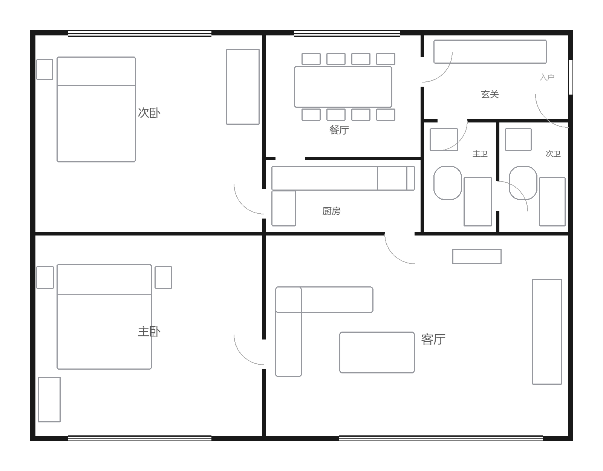
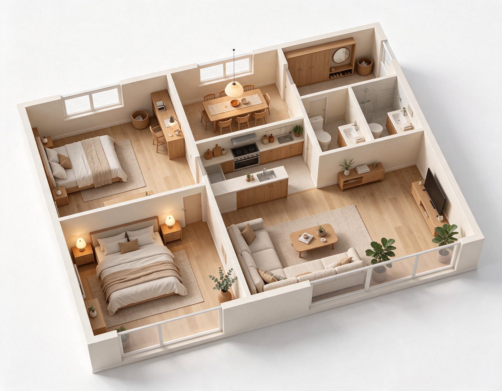
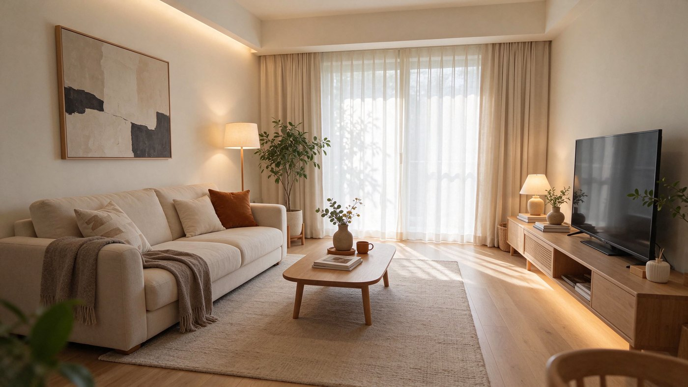

# 户型图生装修效果图

**Floorplan to Interior Render** — 把一张户型平面图做成成套装修效果图。

剖切鸟瞰 → 逐空间实景 → 设计构思文案，四个节点串行、逐节点审批。
出图走腾讯云 **TokenHub · Seedream v5.5**（`seedream-image-v5.5`）参考生图接口。

纯 Markdown + Python 脚本，只依赖标准库和 Pillow，不绑任何框架。

---

## 效果长什么样

| 输入：户型平面图 | 输出：剖切鸟瞰 |
| --- | --- |
|  |  |



> 上面这组是自绘的示意户型（3室2厅2卫，原木奶油风）。
>
> **先讲清能力边界**：这是参考生图，不是 ControlNet 那种结构约束。
> 房间数量、相对方位、功能归属能对上，**门洞位置与墙体厚度不会像素级一致**。
> 拿它做方案沟通、博主内容、客户初筛都合适；要施工图，还是得找设计师出。

---

## 为什么不是"一句提示词直接出图"

单条提示词生成的室内图，十张里有九张是空房子。这个技能用四件事把质量拉起来：

1. **四节点分段审批** —— 拆解 → 鸟瞰 → 实景 → 文案。每步停下来让你确认，跑偏了只废一张，不会废一套。
2. **五段式提示词** —— 机位 / 家具主件 / **软装与道具** / 风格串+灯光 / 排除项。第三段是画面不空的关键。
3. **软装元件库** —— 八条丰富度法则（631 配色、材质 3~5 种、三段高度层、三层光、生活痕迹），逐空间道具清单。
4. **签名单品重复** —— 每个风格固定 2~3 件小物跨房间重复出现，这是成套感的来源。

另有 15 种风格的配色表、材质、软装清单与避坑说明，见 `references/style-list.md`。

---

## 快速开始

### 1. 安装

技能目录放在 WorkBuddy 的 skills 下：

```bash
# macOS / Linux
git clone https://github.com/<your-name>/floorplan-to-interior-render.git \
  ~/.workbuddy/skills/floorplan-to-interior-render

# Windows (PowerShell)
git clone https://github.com/<your-name>/floorplan-to-interior-render.git `
  "$env:USERPROFILE\.workbuddy\skills\floorplan-to-interior-render"
```

装完**重启 WorkBuddy**——技能清单在会话启动时加载。

装到别的位置也能用，脚本之间是相对路径引用，只是要自己记住路径。

### 2. 申请 API Key

> 这个仓库**不含任何密钥**，需要你自己的腾讯云账号。

| 步骤 | 地址 | 做什么 |
| --- | --- | --- |
| ① | <https://console.cloud.tencent.com/tokenhub/overview> | 注册腾讯云 → 实名认证 → 开通「大模型服务平台 TokenHub」 |
| ② | <https://console.cloud.tencent.com/tokenhub/models> | 模型广场里找到 **`seedream-image-v5.5`**，领免费体验额度，**或者直接开启按量付费** |
| ③ | <https://console.cloud.tencent.com/tokenhub/apikey> | 创建 API Key，**创建后立刻复制**（只完整显示一次） |

**第 ② 步最容易卡住，单独说清楚：**

`seedream-image-v5.5` 有两条路可以走——领**免费体验额度**，或开**按量付费**。
两条都没生效时，接口返回 **`402` / code `401007`**：

> 无可用免费体验额度，且未开启后付费

看到这个别怀疑 Key、也别怀疑提示词，去模型广场把该模型的**按量付费**打开就好。
开通前所有调用立即失败、**不扣费**，可以放心调试。

创建 Key 时如果选了「限定范围」，记得勾上 `seedream-image-v5.5`，
否则调用会返回 `401006 model not in allowed list`。拿不准就选「全选」。

### 3. 写入 Key

```bash
python ~/.workbuddy/skills/floorplan-to-interior-render/scripts/seedream.py \
  --set-key sk-你的key
```

写入 `~/.floorplan-render/config.json`（POSIX 下权限 600），**不在项目目录里，不会被提交**。

也可以用环境变量或单次参数，优先级：`--key` > `TOKENHUB_API_KEY` > 本地配置。

```bash
export TOKENHUB_API_KEY=sk-你的key          # macOS / Linux
setx TOKENHUB_API_KEY "sk-你的key"          # Windows（需重开终端）
```

### 4. 验证

```bash
cd ~/.workbuddy/skills/floorplan-to-interior-render

python scripts/seedream.py --show-key        # 看 Key 来源（脱敏显示）
python scripts/seedream.py --prompt "test" --size 1280x720 --out /tmp/_probe.png
```

第二条能出图，就通了。失败对照：

| 现象 | 原因 | 处理 |
| --- | --- | --- |
| `401` | Key 无效、拼错、被截断 | `--set-key` 重写 |
| `402` / `401007` | 免费额度用尽且未开按量付费 | 模型广场开该模型按量付费 |
| `400` / `401006` | Key 可访问范围没勾这个模型 | 重建 Key，范围选全选 |
| 提示未配置 Key | 还没跑 `--set-key` | 见第 3 步 |

---

## 使用

装好后直接跟 AI 说：

> 把这张户型图做成原木奶油风的装修效果图

技能会按三轮问你（户型图 → 风格 → 范围），然后进四节点流程。
每一步的产出都会推到预览，不用自己去翻目录。

### 四个节点

| 节点 | 产出 | 你要做的 |
| --- | --- | --- |
| 1 · 户型拆解 | 参数表 + 编号标注图 | 确认房间数、主卧/公卫/公共区位置对不对 |
| 2 · 鸟瞰顶视图 | A/B 两版剖切鸟瞰 | 选一版，它成为后面所有实景图的风格基准 |
| 3 · 分区实景 | 逐空间室内效果图 | 见下方两条路线 |
| 4 · 设计构思 | 100~150 字文案 | 确认说法和定稿图一致 |

### 两条出图路线

节点 3 开工前会让你选：

- **A · 先出主空间**（推荐）—— 先出客厅 1~2 张，风格和软装你点头后再出其余全部。
  风格没试过、想省额度就走这条，跑偏只废一张。
- **B · 一次性全出** —— 全部房间一次跑完，出完给一张总览。快，但跑偏要整组返工。

---

## 目录结构

```
floorplan-to-interior-render/
├── SKILL.md                       技能主文档：九条铁律、推送纪律、四节点流程
├── references/
│   ├── api-seedream.md            接口参数、尺寸区间、错误码、能力边界
│   ├── prompt-recipes.md          五段式提示词 + 逐空间机位与软装对照
│   ├── styling-library.md         软装元件库：八条法则 + 逐空间道具 + 材质灯光绿植
│   ├── style-list.md              15 种风格的配色/材质/软装/签名单品/避坑
│   └── render-checklist.md        各节点验收清单
├── scripts/
│   ├── seedream.py                出图客户端：单张 / 批量 / 校验 / 打印请求
│   ├── annotate_plan.py           户型图编号标注
│   └── contact_sheet.py           多图拼总览（交付前必用）
├── templates/
│   └── rooms.manifest.json        批量出图清单样板（8 个房间示例提示词）
└── assets/                        README 用示例图
```

一次渲染的项目目录（生成在你的工作目录里，不在技能目录内）：

```
渲染_<项目名>/
├── 00_原图/          01_拆解/          02_鸟瞰/
├── 03_实景/          04_文案/          prompts/
├── _tmp/             # 调试图，不污染正式目录
└── rooms.json
```

---

## 费用参考

实测量级（2026-11，`2048×1152` 单图）：

- **约 1.8 万 tokens / 张，耗时 20 秒左右**
- 一套 8 间房（含鸟瞰）大约 **15 万 tokens、3 分钟**
- `--validate-only` **不发请求、不花钱**，批量出图前建议先跑一次

单价随模型定价变动，具体以控制台账单为准。

---

## 常见问题

**出的图房间数不对 / 多出一间？**
提示词里逐个点名房间和方位。参考图只给平面图一张，别给多张。

**画面很空，像空房子？**
看 `references/styling-library.md`。空的主因不是模型，是提示词只写了沙发地板墙面三个大件。

**能保证和户型图一模一样吗？**
不能。这是参考生图，没有结构控制。房间数量、方位、功能归属对得上，墙体细节会有偏差。

**原图太糊能用吗？**
房间名和门窗位置看不清的话，出图会瞎猜，建议换清晰的图。技能会在接单时直接告诉你哪块看不清。

---

## 许可

MIT，见 [LICENSE](LICENSE)。

用的是腾讯云的服务，API 调用产生的费用与合规责任由使用者自行承担。
